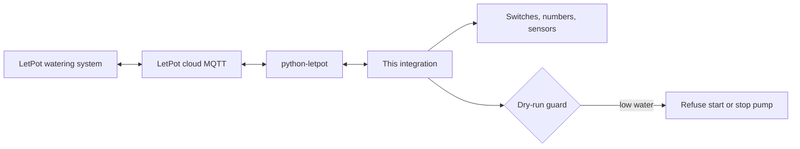

# LetPot for Home Assistant

A HACS integration that adds LetPot automatic watering systems (DI-2 and DI-3) to Home Assistant, with a dry-run guard that keeps the pump from running on an empty tank.

[](https://hacs.xyz)


**Status: in testing.** On/off control of the pump is confirmed on the maintainer's own device. The cycle settings, timestamp sensors and dry-run protection are written and unit tested but have not been run against real hardware yet, so treat them as unproven.

This project comes with no warranty or guarantee of fitness for any purpose. Use it at your own risk.

**LLM use:** This project is built with substantial AI assistance (Claude Code). The maintainer tests it on a real device and decides what ships.

## What this does

Home Assistant core already ships a `letpot` integration, but it only covers LetPot's hydroponic gardens. This repository is a copy of that integration, under the same `letpot` domain, with the watering systems added. HACS installs it over the built-in one, and your existing LetPot config entry keeps working.

The integration talks to LetPot's cloud (MQTT) through [python-letpot](https://github.com/jpelgrom/python-letpot). Each watering system shows up as a device with a pump switch, its cycle settings as number and select entities, and sensors for the next and last watering.



## Use cases

- Water on your own schedule from an automation, for example only when a soil moisture sensor reads dry and the forecast shows no rain.
- Change the cycle (how often, how long, continuous or intermittent) from a dashboard instead of the LetPot app.
- Stop an empty reservoir from burning out the pump, even when the run was started by the device's own schedule.

## Getting started

1. In HACS, open the menu, choose **Custom repositories**, and add `https://github.com/tmeuze/ha-letpot` as an **Integration**.
2. Download it and restart Home Assistant fully. A reload is not enough, because Home Assistant has to load the new code.
3. If the built-in LetPot integration is already set up, you're done. Otherwise go to **Settings, Devices & services, Add integration**, search for LetPot, and sign in with your LetPot app account.
4. Open the device page and check that the entities below are there.

## Entities

| Entity | Type | What it does |
|---|---|---|
| Pump | Switch | Start or stop watering by hand |
| Cycle watering | Switch (config) | Turn the repeating cycle on or off |
| Dry-run protection | Switch (config) | Turn the low-water guard on or off |
| Manual watering duration | Number, minutes | How long a manual run lasts |
| Cycle frequency | Number, hours | How often the cycle starts |
| Cycle duration | Number, minutes | How long each cycle run lasts |
| Cycle work interval, Cycle rest interval | Number, seconds | On and off times in intermittent mode |
| Cycle mode | Select | Continuous or intermittent |
| Pump running, Low water | Binary sensor | Whether the pump is on, and whether the tank is low |
| Next watering, Last watering, Watering ends at | Sensor, timestamp | Rounded to the minute |
| Last watering reason | Sensor (diagnostic) | Manual, cycle, scheduled, interrupted, or never run |

## Dry-run protection

The device reports a low-water flag, and the guard works from it. It is on by default and has its own switch per device.

- While low water is reported, turning on the pump or the cycle is refused with a message saying why.
- If low water appears while the pump is running, the integration sends a stop. If the cycle started that run, it also switches the cycle off, which is how the device interrupts a cycle run.
- A run that the device starts by itself can't be prevented. It's stopped when the next status update arrives, usually within a second.
- If the device doesn't report the flag, nothing is blocked. If your sensor reports low water wrongly, turn the switch off.

The low-water flag comes from reverse engineering, and nobody has confirmed it across models or firmware (VERIFY). Don't make it your only protection. Keep the intake submerged, and consider a float switch.

## Known limits

- It needs LetPot's cloud. There is no local control.
- Some users report the pump occasionally refusing to start until the device is hard reset.
- Writing cycle settings uses private helpers from python-letpot 0.7.0, because the library has no public setters for them yet.
- An older community version overrode the library's write encoder, which stored a 3 minute duration as 768 minutes on some devices. This integration uses the library's encoder unchanged, and a test guards against reintroducing the override. If your device was affected, set the manual duration again from the number entity here or from the LetPot app. A Home Assistant helper doesn't change what's stored on the device.

## Tests

```bash
pip install letpot==0.7.0
python -I -m unittest discover tests
```

The tests don't need Home Assistant or a device. They cover the write encoding, the dry-run policy and the repair tool.

[`tools/repair_manual_duration.py`](tools/repair_manual_duration.py) is a one-time terminal tool, from HSTEP's fork, for reading or restoring a DI-3's stored manual duration. It only reads unless you pass `--apply`. Run it with `--help` first.

## Documentation

| | |
|---|---|
| [Where this got to](docs/STATE.md) | What works, what's untested, what to try next |
| [Decisions](docs/decisions.md) | The choices behind the encoder, the guard and the layout |
| [Credits](docs/credits.md) | Where the code comes from |
| [Changelog](CHANGELOG.md) | What changed and when |

## Where this came from

This started as [HSTEP's custom component](https://github.com/HSTEP/letpot2.0-home-assistant) for the DI-3, which is itself a fork of the core integration by [@jpelgrom](https://github.com/jpelgrom). The plan is to send this work upstream, first to HSTEP and then to Home Assistant core and python-letpot. Home Assistant's [AI policy](https://developers.home-assistant.io/docs/ai_policy) applies to anything sent to core.

## Licence

No licence file has been added yet (VERIFY which one applies). The code derives from Home Assistant core, which is Apache 2.0.
